# Flows

Mermaid diagrams render in GitHub / most Markdown previews. File paths point at the implementing modules.

---

## App boot

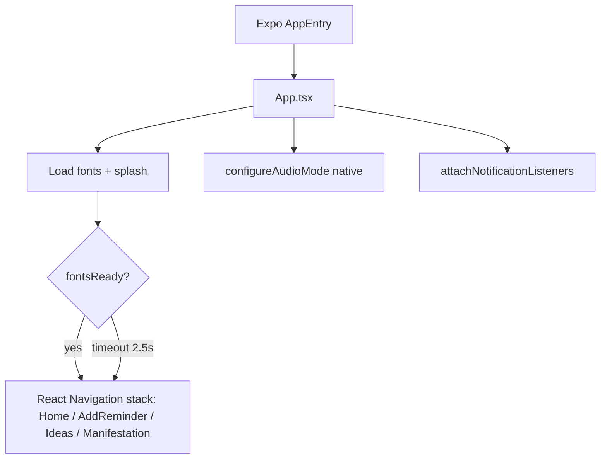

---

## Home session loop

```mermaid
flowchart TD
  H[index.tsx mount] --> L[loadReminders + loadSyncScore]
  L --> A[setAuraScore on Manifest deck]
  L --> R{Ritual for hour?}
  R -->|morning/evening not yet today| S[WarmInboundBubble ritual script]
  L --> HY[Poll hype candidates every 30s]
  L --> FU[Poll due memories every 20s]
  L --> LN{Hour 0–5?}
  LN -->|yes| DR[Offer late-night boundary / decompress]
```

### Complete a task

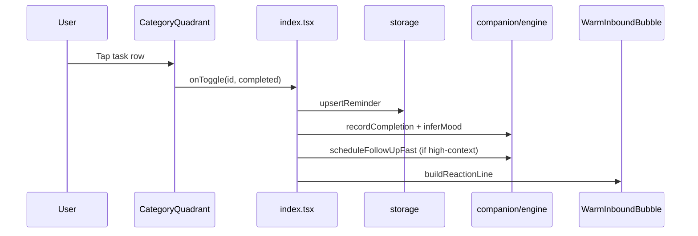

---

## Voice → multi-bucket tasks

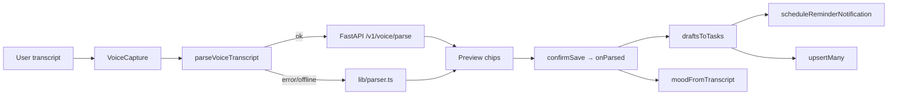

**High-context follow-up eligibility** (`isHighContextTask`): trading / client / interview / deploy-like titles, or `contextTrigger` / elevated priority — see `lib/companion/scripts.ts`.

---

## Hype interstitial (pre-event)

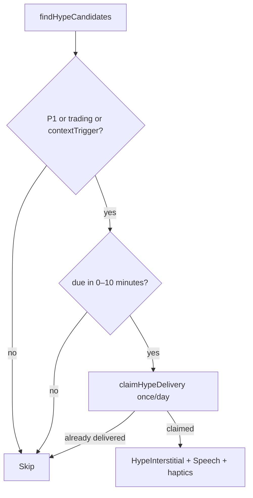

---

## Decompression Room

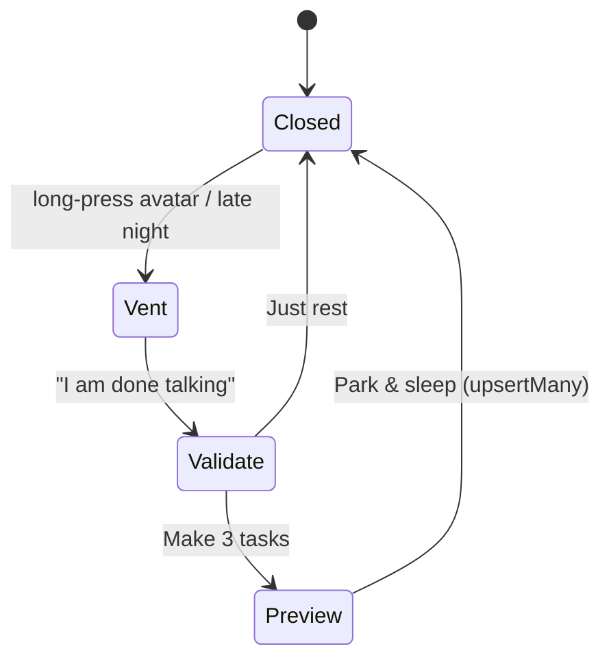

---

## Manifestation Identity Shift

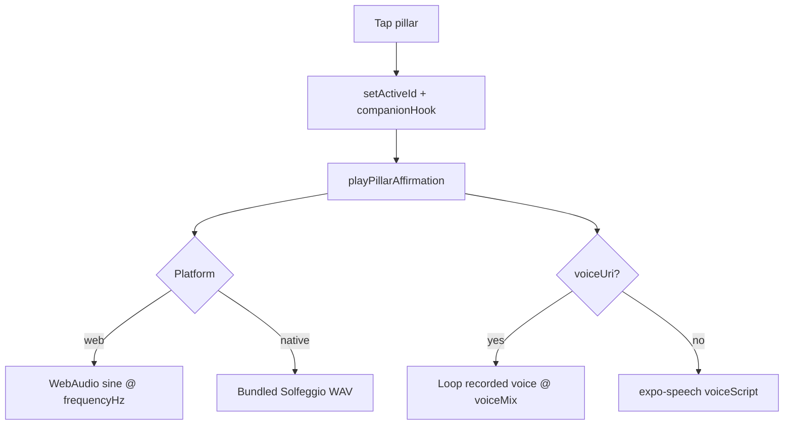

### Reality Lock (60s)

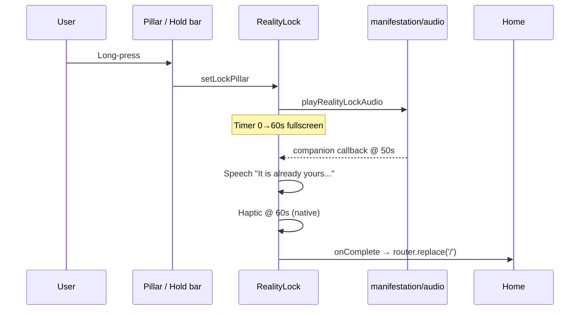

### Voice Echo

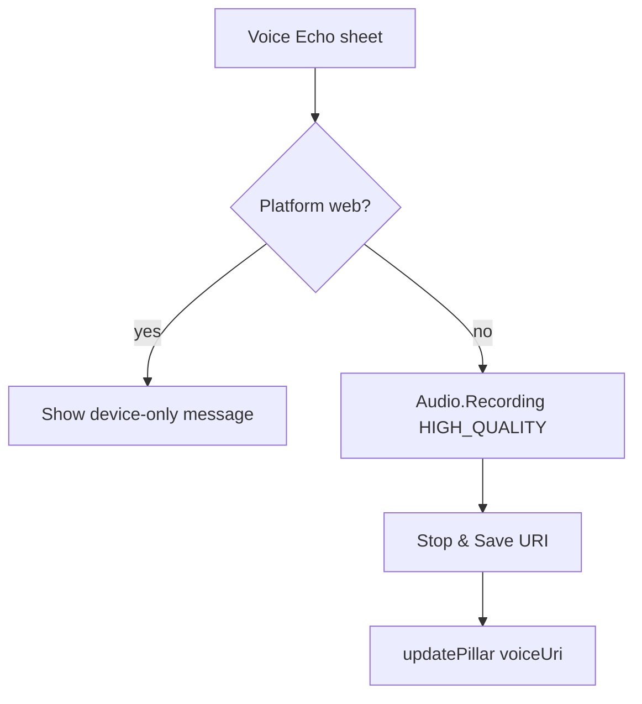

### Vision Synthesizer (current)

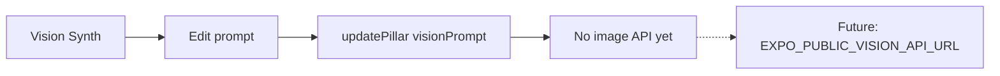

---

## Ideas vault capture

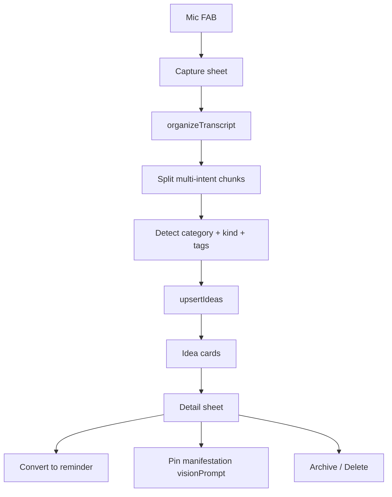

---

## Storage write paths

| Action | Module | Key |
| --- | --- | --- |
| Upsert reminders | `lib/storage.ts` | `@reminders/v2` |
| Companion memories | `lib/companion/engine.ts` | `@companion/memories/v1` |
| Bio snapshot | same | `@companion/bio/v1` |
| Sync score | same | `@companion/sync/v1` |
| Ritual day stamps | same | `@companion/rituals/v1` |
| Hype claims | same | `@companion/hype-delivered/v1` |
| Completions/hour | same | `@companion/completions-hour/v1` |
| Manifest deck | `lib/manifestation/storage.ts` | `@manifestation/deck/v1` |
| Theme id | `lib/theme/storage.ts` | `@everly/theme/v1` |

All writers use AsyncStorage with web `localStorage` and in-memory fallbacks for restricted environments.
